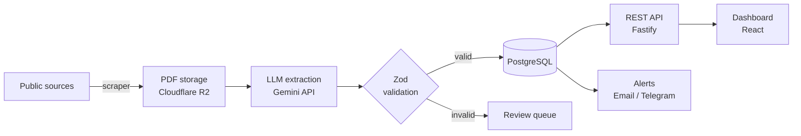

# 🔎 Radar de Editais

> AI-powered tracker for Brazilian public-sector IT job exams (*concursos*): it finds the notices, reads them for you and alerts you when something matches.

---

## 💡 The problem

In Brazil, government jobs are filled through public exams announced in **editais**: long PDF notices published across dozens of different websites.

If you're an IT professional looking for one, you have to:

- check several sites every week,
- open 80-page PDFs to find out whether there's even an IT position,
- dig for salary, deadlines, exam board and syllabus by hand.

**Radar de Editais automates all of that.**

## ✨ What it does

| Feature | Description |
|---|---|
| 🕷️ **Collect** | Scrapes new editais from public sources |
| 🤖 **Extract** | Uses an LLM to turn each PDF into structured data: role, salary, key dates, exam board and syllabus |
| ✅ **Validate** | Every extracted field is checked against a typed schema before it's saved |
| 📊 **Explore** | Dashboard with filters by role, salary, state, board and deadline |
| 🔔 **Alert** | Email or Telegram notification when a new edital matches your filters |

## 🏗️ Architecture

## 🧰 Tech stack

| Layer | Choice | Why |
|---|---|---|
| Frontend | React + TypeScript + Vite | Fast DX, typed end to end |
| Backend | Node.js + Fastify | Lightweight, schema-first, great TS support |
| Validation | Zod | One schema shared by the LLM output, the API and the frontend |
| AI | Gemini API (behind an `LLMProvider` interface) | Long context for big PDFs; swappable provider |
| Database | PostgreSQL (Docker locally, Neon in production) | Relational data and solid filtering |
| File storage | Cloudflare R2 (S3-compatible) | Stores the original PDFs |
| Infra | Docker + Docker Compose | One command to run everything |

## 🗺️ Roadmap

- [x] Project setup and README
- [ ] Scraper collecting editais from one source
- [ ] Data persisted in PostgreSQL (Docker)
- [ ] LLM extraction from a single edital
- [ ] Batch extraction with field validation
- [ ] REST API
- [ ] Dashboard listing editais
- [ ] Dashboard filters
- [ ] Email / Telegram alerts
- [ ] Deploy with live demo
- [ ] Final docs and screenshots

**Out of scope for the MVP:** user accounts, payments, mobile app.
 
### 💭 Future ideas
 
- 🏷️ **IT role taxonomy:** normalize generic titles ("Analista Legislativo", "Vários cargos") into categories such as Dev, Infra, Data, Security and Support
- 📍 **Filter by distance:** e.g. editais within 100 km of Recife, using IBGE municipality coordinates
- 🌐 **More sources:** a multi-source scraper (exam boards and other aggregators)

## 🚀 Getting started

> 🚧 Coming soon. The project will run with a single `docker compose up`.

## 👩‍💻 Author

**Maise Perini Maya**, full stack developer (React, Vue, TypeScript, Python, generative AI)

[LinkedIn](#https://www.linkedin.com/in/maisemaya/) · [Portfolio](#https://github.com/maisepmaya)

## 📄 License

MIT
