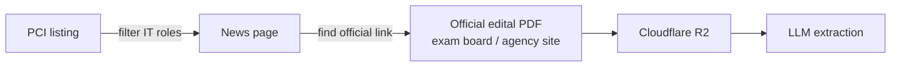

# 🕷️ Scraper notes

Research notes for the first data source (milestone: *scraper collecting editais from one source*).

## Source decision

| Source | Verdict | Why |
|---|---|---|
| [PCI Concursos](https://www.pciconcursos.com.br/concursos/) | ✅ **Primary (MVP)** | National coverage on a single page; separate fields for role, education level, salary and deadline make it easy to filter IT positions |
| [Concursos no Brasil](https://concursosnobrasil.com/concursos/sp/) | 🔜 Future 2nd source | Listing only has *agency* and *openings*; the other details live in the link title. Good candidate for a multi-source scraper later |

## Page structure (PCI)

- Server-rendered HTML → **Cheerio** is enough (no headless browser needed).
- Grouped by **Nacional → Region → State**.
- Each entry has:
  - **Agency** (links to a `/noticias/` article)
  - **State (UF)**
  - **Openings + max salary** (e.g. "29 vagas até R$ 13.359,44", sometimes "Cadastro de reserva")
  - **Roles** (one or more)
  - **Education level** (`Fundamental / Médio / Técnico / Superior`)
  - **Registration deadline** (date, range, or status such as *Prorrogado*, *Reaberto*, *Suspenso*)
- No direct link to the edital PDF on the listing page.

## Pipeline

1. **Discover**: scrape the PCI listing and keep only IT roles (keywords: *TI, Tecnologia da Informação, Analista de Sistemas, Desenvolvedor, Programador, Suporte, Infraestrutura, Dados, Segurança da Informação*).
2. **Resolve**: open the news page and grab the link to the **official** edital.
3. **Download**: fetch the PDF from the **official source**, store it in R2 and send it to the LLM.

## Data & ethics

- **Editais are public.** Under Brazilian copyright law (Lei 9.610/98, art. 8, IV), official acts are not protected by copyright.
- **Aggregators' content is not ours.** PCI's articles and curated listings belong to them, so we use them **only for discovery** (links + basic metadata) and **never republish their text**.
- **Always cite the source.** Every edital in the dashboard links back to the official document.
- **Respect `robots.txt`.** PCI allows `/concursos/` and disallows `/*.pdf` and `/*.php`, which is another reason to download PDFs from the official sources.
- **Be polite.** Identified User-Agent, max **1 request/second**, and caching to avoid re-fetching unchanged pages.
- **Non-commercial** portfolio project.

## Open questions

- [ ] Check PCI's terms of use (site footer)
- [ ] How to detect "new" editais between runs (hash of agency + role + deadline?)
- [ ] How often to run the scraper (once a day is probably enough)
